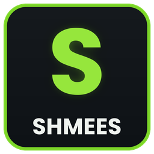
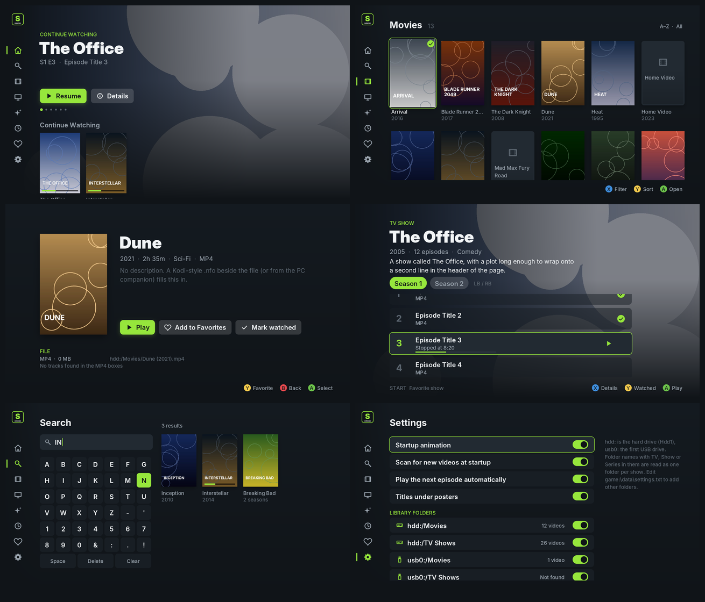

# Shmees Media Center

A media center for the Xbox 360, written from scratch. Browse your movies and shows with posters, pick up where you
left off, and play video with sound on a console that runs homebrew.

> **Status: in development.** Version 0.3 plays H.264/AAC MP4 video with sound on a real Xbox 360 Slim.
> Version 0.5 adds a sixth decoding thread and an optional vector-unit mode, and hasn't been tested on a console yet.
> See [DEVLOG.md](DEVLOG.md) for what's been tested and where.

## What it does

- **Library:** Movies, TV shows with seasons and episodes, Recently Added, Continue Watching, Favorites and Search.
- **Playback:** MP4 video (H.264 with AAC sound) with seeking, resume, watched marks and next episode. 720p and below
  play at full quality; 1080p is still short of full frame rate.
- **Metadata:** Kodi-style `.nfo` files (the format tinyMediaManager, Jellyfin and Kodi write), posters and backdrops.
- **Drives:** scans `Hdd1:\Movies`, `Hdd1:\TV Shows` and the same folders on USB drives.
- **Controller:** everything works from the controller, including an on-screen keyboard for search.
- Launches from Aurora and exits back to it. It only writes inside its own folder.

## Requirements

- An Xbox 360 that runs unsigned code (RGH, JTAG, or a BadUpdate-style softmod such as XeUnshackle).
- The Aurora dashboard (or any way to launch a homebrew `.xex`).

## Install

1. Download the latest zip from [Releases](../../releases) and unzip it.
2. Copy the `Homebrew` folder to the root of `Hdd1` on the console (over FTP from Aurora, or with a USB drive).
3. Put videos in `Hdd1:\Movies` and `Hdd1:\TV Shows\<Show name>\Season 1\`.
4. In Aurora, open the file manager, go to `Hdd1:\Homebrew\ShmeesMediaCenter` and launch `ShmeesMediaCenter.xex`.

Full steps, folder layouts and troubleshooting are in [INSTALL.txt](INSTALL.txt).

**File names on Hdd1 can be at most 42 characters, extension included.** That's a limit of the console's FATX file
system, and longer names fail to copy. USB drives don't have the limit.

## Building

The app is built with [xsdk](https://github.com/xenosworks/xsdk) (GCC for `powerpc-xsdk-elf`, newlib, a GPU layer and
`elf2xex.py`). No Microsoft XDK is used.

- `tools/build_ffmpeg.sh` cross-builds FFmpeg (LGPL, without GPL parts) with `tools/ffmpeg-xsdk.patch`.
- `tools/gen_assets.py` renders the Inter font atlas, icons and the S badge into `src/gen/smc_assets.h`.
- `CMakeLists.txt` builds `ShmeesMediaCenter.xex`; `vmxprobe/` builds the separate vector-instruction probe.

## Licence

Shmees Media Center's own code is under the MIT licence (see [LICENSE](LICENSE)). It uses xsdk (MIT), libxenon and
Xenia code (BSD), FFmpeg (LGPL 2.1), stb_image (public domain / MIT) and the Inter font (SIL OFL 1.1); their notices
are in [NOTICES.md](NOTICES.md) and [LICENSE-FFmpeg-LGPL-2.1.txt](LICENSE-FFmpeg-LGPL-2.1.txt).

Not affiliated with Microsoft. Xbox 360 is a trademark of Microsoft Corporation. Use it offline, at your own risk.

Made by Shmees.
